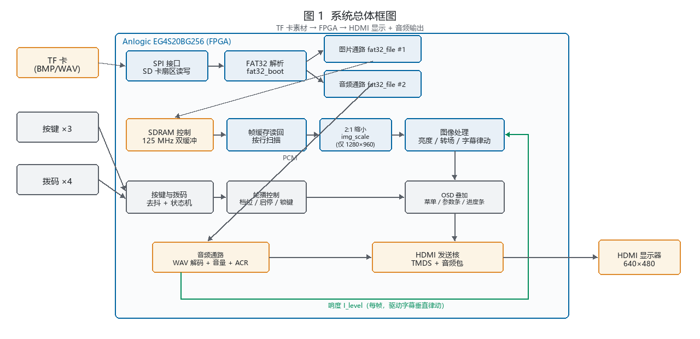
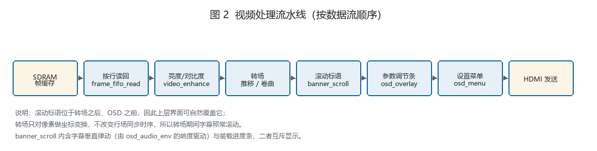
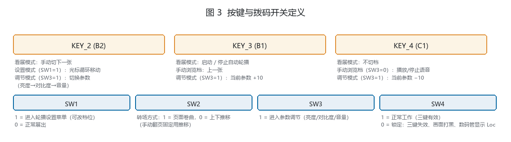
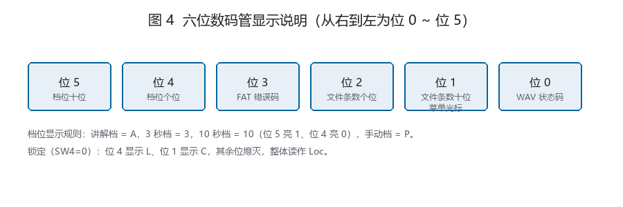
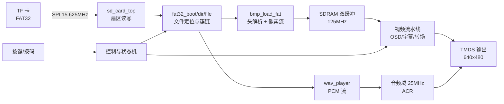

<div align="center">

# FPGA 音视频播放器

**太阳神鸟金饰数字展示系统** · 640×480 HDMI · TF 卡 FAT32 · 卷曲转场 · 音频联动字幕

[](LICENSE)
[](https://www.anlogic.com/)
[](docs/build.md)
[](#)
[](#12-资源与时序)
[](#12-资源与时序)

一款在 **安路 EG4S20** FPGA 上实现的纯硬件音视频播放器：从 **TF 卡**读取 BMP 图片与 WAV 语音，
经 **SDRAM 双缓冲**输出 **640×480 HDMI**，并叠加 OSD 菜单、滚动字幕与随音频律动的文字动画。
不含 CPU、不含软核、不含操作系统——全部由 RTL 状态机直接完成文件系统解析、图像缩放与像素渲染。

</div>

---

## 目录

- [1. 项目简介](#1-项目简介)
- [2. 功能特性](#2-功能特性)
- [3. 效果预览](#3-效果预览)
- [4. 硬件与接线](#4-硬件与接线)
- [5. TF 卡素材规范](#5-tf-卡素材规范)
- [6. 目录结构](#6-目录结构)
- [7. 环境依赖](#7-环境依赖)
- [8. 快速开始](#8-快速开始)
- [9. 构建](#9-构建)
- [10. 烧录与固化](#10-烧录与固化)
- [11. 验证](#11-验证)
- [12. 资源与时序](#12-资源与时序)
- [13. 设计要点](#13-设计要点)
- [14. 已知限制](#14-已知限制)
- [15. 常见问题](#15-常见问题)
- [16. 许可证与致谢](#16-许可证与致谢)

---

## 1. 项目简介

传统 FPGA 播放图片需要把像素烧进 ROM，改一张图就要重新综合。本项目换了一条更实用的路线：
**把媒体文件放在 TF 卡上，由 FPGA 直接解析 FAT32 并流式读取**。改素材只需拔卡、拷文件、插回，无需重新编译。

为了实现"能看、能听、有讲解感"，工程在播放之外还做了三件事：

1. **转场**：换图时做逐像素坐标变换的"卷曲"效果（另有上下推移模式可切换）；
2. **讲解联动**：BMP 与同名 WAV 成对装载，语音播放时底部字幕随响度上下律动，形成从左到右的行波；
3. **现场可用**：OSD 菜单、亮度/对比度/音量三级调节、按键锁定、数码管状态指示，适合展会长时无人值守。

整个设计**可复现**：两份独立构建产出的比特流配置区逐位一致（`Bitstream CRC` 相同）。

---

## 2. 功能特性

| 功能 | 说明 |
|---|---|
| **TF 卡播放** | 上电自动解析 FAT32 根目录，最多装载 **4 组** 素材（BMP + 同名 WAV） |
| **图片轮播** | 支持 640×480 直通，或 1280×960 自动 2:1 缩小；讲解 / 3 秒 / 10 秒 / 手动 四档 |
| **手动浏览** | 手动档下 KEY_2 / KEY_3 前后翻页（首尾循环），KEY_4 播放 / 停止当前图配对语音 |
| **语音讲解** | WAV 经 HDMI 音频通道输出，音量 0~100 可调 |
| **卷曲转场** | `video_curl` 逐像素坐标变换，转场 2.35 秒；SW2 可切换为上下推移 |
| **OSD 菜单** | SW1 打开，四项模式选择，选中行反白 + 金色左条 |
| **参数调节条** | SW3 打开，三页轮转：亮度 → 对比度 → 音量；步长 10，3 秒后自动消失 |
| **滚动字幕** | 10 字 × 32 px 文字块，119 px/s 左移，转场期间不中断 |
| **音频联动** | 每个字随 120–480 Hz 频段能量上下律动，逐字滞后约 302 ms 形成行波 |
| **装载进度条** | 换图装载期间底部条带变为从左向右填充的进度条 |
| **按键锁定** | SW4=0 时三键全锁，数码管显示「锁」 |

---

## 3. 效果预览

| 系统总体框图 | 视频处理流水线 |
|---|---|
|  |  |

| 按键与拨码定义 | 数码管显示说明 |
|---|---|
|  |  |

更完整的操作手册见 [`docs/manual-zh.pdf`](docs/manual-zh.pdf)（13 章 + 2 附录，28 页），
技术选型分层见 [`docs/images/tech-stack.png`](docs/images/tech-stack.png)。

---

## 4. 硬件与接线

### 4.1 板卡

| 项 | 参数 |
|---|---|
| FPGA | 安路 **EG4S20BG256**（19,600 LUT / 9,800 slices / 64 ERAM / 29 DSP） |
| 配置 Flash | **W25Q16**（16 M-bit / 2 MB），接芯片固定 MSPI 口，**无需引脚约束、无启动跳线** |
| 下载口 | 板载 USB-JTAG（AL-LINK 兼容），同时兼供电 |
| 系统时钟 | 50 MHz 有源晶振（引脚 R7） |
| 显示输出 | HDMI（TMDS，640×480 @ 60 Hz） |
| 片外存储 | 板载 SDRAM，用作双缓冲帧缓存（125 MHz） |

### 4.2 TF 卡接线（SPI 模式）

TF 卡座工作在 **SPI 模式**，只占用 4 根信号线，全部为 3.3 V LVCMOS33：

| FPGA 信号 | 引脚 | 方向 | TF 卡座引脚 | 说明 |
|---|---|---|---|---|
| `sd_ncs` | **A12** | 输出 | 2 — CS / DAT3 | 片选，低有效 |
| `sd_dclk` | **A14** | 输出 | 5 — CLK | SPI 时钟 |
| `sd_mosi` | **A13** | 输出 | 3 — CMD / DI | 主机 → 卡 |
| `sd_miso` | **B14** | 输入 | 7 — DAT0 / DO | 卡 → 主机 |
| `3.3V` | — | 电源 | 4 — VDD | 卡座供电 |
| `GND` | — | 电源 | 6 — VSS | 共地 |

> TF 卡座其余引脚（DAT1 / DAT2 / CD）在 SPI 模式下悬空或按卡座规格上拉即可。
> 若自制底板：`sd_miso` 建议加 10 kΩ 上拉到 3.3 V，`sd_ncs` 建议加 10 kΩ 上拉，避免上电瞬间误入 SD 模式。

SPI 时钟由 `sd_card_clk`（62.5 MHz）分频得到：

| 阶段 | 分频参数 | 实际频率 |
|---|---|---|
| 初始化（CMD0/CMD8/ACMD41） | `SPI_LOW_SPEED_DIV = 248` | 125 kHz |
| 数据传输（CMD17/CMD24） | `SPI_HIGH_SPEED_DIV = 0` | **15.625 MHz** |

### 4.3 按键、拨码与数码管

| 板上丝印 | 顶层信号 | 引脚 | 功能 |
|---|---|---|---|
| KEY_2 | `key1` | B2 | 手动档：下一张；其余档：被禁用并提示「自动轮播中」 |
| KEY_3 | `key2` | B1 | 启动 / 停止自动轮播；手动档下改为「上一张」 |
| KEY_4 | `key3` | C1 | 播放 / 停止语音（手动档）、开关字幕律动、参数 −10 |
| SW1 | `sw1` | C8 | 1 = 设置菜单 |
| SW2 | `sw2` | C7 | 1 = 卷曲转场，0 = 上下推移 |
| SW3 | `sw3` | C6 | 1 = 参数调节条 |
| SW4 | `sw4` | C5 | 0 = 锁定三键 |
| 复位 | `rst_n` | A2 | 低有效 |
| 数码管 | `seg_sel[5:0]` / `seg_data[7:0]` | E12/E10/C13/F10/E11/D11，C15/C16/B6/A5/B5/A8/A7/A6 | 状态码显示 |

> 音频**随 HDMI 一并传输**（TMDS 数据岛 + ACR 重建 48 kHz 采样时钟），板载 I2S 排针约束已注释、本设计未启用。

---

## 5. TF 卡素材规范

> **完整说明见 [`docs/tf-card.md`](docs/tf-card.md)** —— 接线、FAT32 约束、模块分层、时序、排障全在里面。

一句话版本：**卡格式化为 FAT32，根目录放最多 4 组「前两个字符同名」的 BMP + WAV**。

| 项 | 要求 |
|---|---|
| 文件系统 | **FAT32**（不支持 exFAT / NTFS / FAT16），文件放**根目录** |
| 文件名 | **8.3 短文件名**，如 `01.BMP` / `01.WAV` |
| 配对规则 | BMP 与 WAV 的**前两个字符相同**即为一对（`01.BMP` ↔ `01.WAV`，大小写不敏感） |
| 组数 | 最多 **4 组**（`SCAN_TARGET_COUNT = 4`） |
| BMP | **24 位真彩色、未压缩（BI_RGB）**；640×480，或 1280×960（装载时 2:1 缩小） |
| WAV | **PCM、单声道、48 000 Hz、16 bit** |

### 生成合规素材（免装图形软件）

```bash
# 生成一组示例：640×480 渐变图 + 1 kHz 正弦 48 kHz 单声道 WAV
python tools/make_media.py --out ./sdcard --index 01
# 进阶：自定义尺寸（1280×960 会被自动缩小）、时长、频率
python tools/make_media.py --out ./sdcard --index 02 --size 1280x960 --seconds 8 --freq 660
```

把 `sdcard/` 下的 `01.BMP`、`01.WAV`、`02.BMP`、`02.WAV` 拷到卡根目录即可。

用 FFmpeg 也可以：

```bash
# WAV：单声道 / 48 kHz / 16 bit
ffmpeg -i input.mp3 -ac 1 -ar 48000 -sample_fmt s16 -acodec pcm_s16le 01.WAV
# BMP：24 位、640×480、不压缩
ffmpeg -i input.jpg -vf scale=640:480 -pix_fmt bgr24 01.BMP
```

---

## 6. 目录结构

```
fpga-audio-visual-player/
├── README.md                      ← 你在看的这份
├── LICENSE
├── THIRD-PARTY-NOTICES.md          第三方与参考设计的逐模块边界
├── .gitignore / .gitattributes
│
├── hardware/                      ★ TD 工程（可直接用 TD 打开）
│   └── hdmi_media_player/src/
│       ├── td_project/
│       │   ├── hdmi_media_player.al         GUI 工程文件
│       │   ├── flow_holdfix.tcl             构建流程脚本（修正 TD 默认流程的 fix_hold 门控）
│       │   ├── al_ip/                       IP 配置文件（PLL）
│       │   └── hdmi_media_player_Runs/
│       │       ├── syn_1/                   综合 run（settings.cfg / .prj）
│       │       └── phy_1/                   实现 run（settings.cfg / .prj）
│       └── user_source/
│           ├── hdl_source/                  全部 RTL（46 个自写 .v + 厂商 IP 与加密核）
│           │   ├── top.v                    顶层
│           │   ├── SD/                      ★ TF 卡驱动 + FAT32 + 播放器（19 个文件）
│           │   ├── ip/                      厂商 IP（PLL / 异步 FIFO）
│           │   ├── include/                 全局宏与查找表
│           │   └── hdmi1.4b_transmitter_core/  TMDS 发送核（加密交付）
│           └── constraints_source/          pin.adc / timing.sdc / edid_debug.cwc
│
├── bitstream/                     可直接烧录的比特流
│   ├── hdmi_media_player_C77.bit   641,264 B
│   ├── MD5.txt
│   └── 版本说明.md                 C70~C79 各版对照与 CRC
│
├── verification/                  独立验证环境（可脱离工程单独跑）
│   ├── bmp_read/                   BMP 解析差分仿真 + 变异测试
│   ├── fat32_tbl/                  FAT32 目录表容量改动的单元验证
│   └── tools/                      Python 校验脚本（像素/对比度/OSD 渲染/复用审计）
│
├── reports/                       C77 完整构建报告（所有对外数字的出处）
├── docs/
│   ├── tf-card.md                 ★ TF 卡存储完整指南
│   ├── build.md                   环境依赖与构建
│   ├── programming.md             烧录与固化
│   ├── faq.md                     常见问题
│   ├── manual-zh.pdf             13 章操作手册
│   ├── third-party-notice.docx    与参考实例的逐项边界（竞赛提交版）
│   └── images/                    文档插图
│
└── tools/
    └── make_media.py              生成合规 BMP + WAV 素材
```

> **为什么不把 RTL 拆成 `rtl/`、`sim/` 再重排？**
> `.al` / `.prj` / `settings.cfg` 里全部是相对路径（`../user_source/...`、`al_ip/PLL.ipc`）。
> 一旦移动源文件，TD 工程就得手工重建。因此本仓库**保持原工程树不动**，
> 代价是 `hardware/` 层次略深，换来的是"克隆下来双击就能打开"。

---

## 7. 环境依赖

| 用途 | 工具 | 版本 / 说明 |
|---|---|---|
| 综合与实现 | **Anlogic TD** | 6.2.1（Engineer 6.2.168.116），器件库 `eagle_s20.db` |
| 下载与固化 | TD BitWriter | 随 TD 安装，或直接跑 `bin\bw.exe` |
| 生成素材 | **Python** | 3.8+，仅用标准库（无需 Pillow / numpy） |
| 可选：跑仿真 | Icarus Verilog | 0.10+，用于 `verification/` 下的 testbench |
| 可选：跑校验脚本 | Python 3 | `verification/tools/` 下脚本 |

> TD 是 Windows 软件，本工程路径全部使用相对写法，可整包搬到任意目录。
> 无 FPGA 硬件也能完成综合与实现，但**上板验证必须有板**。

---

## 8. 快速开始

```bash
# 1) 取代码
git clone https://github.com/fjh77/fpga-audio-visual-player.git
cd fpga-audio-visual-player

# 2) 造素材（也可以用自己的图/音，按第 5 节规格）
python tools/make_media.py --out ./sdcard --index 01

# 3) 把 sdcard/ 下的 01.BMP、01.WAV 拷到 TF 卡根目录，插卡上板
# 4) 烧录现成比特流（无需综合）
#    TD → Tools → BitWriter → Program SRAM → 选 bitstream/hdmi_media_player_C77.bit
# 5) 想改代码？打开 hardware/.../td_project/hdmi_media_player.al 重新构建
```

上电后数码管亮、HDMI 出图即为正常。固化到 Flash（掉电自启动）见 [第 10 节](#10-烧录与固化)。

---

## 9. 构建

详细环境配置与错误码对照见 [`docs/build.md`](docs/build.md)。

### 9.1 TD GUI（推荐）

1. `File > Open Project` → `hardware/hdmi_media_player/src/td_project/hdmi_media_player.al`
2. 仓库**不含 run 数据库**，`syn_1` / `phy_1` 显示未运行属正常
3. 先跑 **`syn_1`**（约 2 分钟，`read_design → opt_gate`）
4. 再跑 **`phy_1`**（约 4 分钟，`opt_place → bitgen`，复用 `syn_1/gate.db`）
5. 产物：`hdmi_media_player_Runs/phy_1/hdmi_media_player.bit`

> **改完 RTL 必做三步，少一步会拿到旧比特流**
> ① `syn_1/settings.cfg` 的 `start_step` 改为 `read_design`
> ② 删掉 `syn_1/` 下的 `.read_design.end.f`、`.opt_rtl.end.f`、`.opt_gate.end.f`
> ③ 跑完核对 `syn_1/gate.qor` 的 `#luts` 是否为预期值

原因：TD 每轮流程结束会执行 `export_flow_status`，**自动把 `start_step` 改回 `opt_place`**。
下一次"重新构建"就只跑布局布线，开头 `import_db ../syn_1/...gate.db`——源码改了也白改。

一条命令判据：

```bash
grep -m1 -E "elaborate|import_db" syn_1/run.log
# elaborate -top top        → 真综合
# import_db ../syn_1/...    → 用了旧网表
```

### 9.2 命令行

```bash
TD=C:/Anlogic/TD_6.2.1_Engineer_6.2.168.116/bin/td_commands_prompt.exe
cd hardware/hdmi_media_player/src/td_project/hdmi_media_player_Runs

# ① 综合（约 2 分钟）→ syn_1/gate.db
(cd syn_1 && "$TD" ../../flow_holdfix.tcl > run.log 2>&1)
# ② 实现 + bitgen（约 4 分钟）
(cd phy_1 && "$TD" ../../flow_holdfix.tcl > run.log 2>&1)
```

> `td_commands_prompt.exe` **不能加任何 flag**（加 `-tcl` / `-source` 会报 `wrong # args`）。
> 进程跑完会停在 `td >` 提示符不退出，用 `taskkill //F //IM td_commands_prompt.exe` 收尾。

> ★ **必须用仓库内的 `flow_holdfix.tcl`，不要用 TD 自带的 `DefaultFlow.tcl`。**
> 后者把"路由后单独跑 `fix_hold`"绑在 `arr_filter` 上（本工程为 false），导致后置 hold 修复从不执行。
> 实测：布局后 hold 为 **−11 ps / 17 端点**，经 `fix_hold` 后变成 **+3 ps / 0 端点**。

### 9.3 构建判据

| 检查 | 命令 | 期望 |
|---|---|---|
| 无 ERROR | `grep -c "^ERROR" run.log` | 0 |
| 悬空 net | `grep -c HDL-5314 run.log` | 2（历史遗留，无害，见 [FAQ](docs/faq.md)） |
| 无死条目 | `grep -c PRJ-7001 run.log` | 0 |
| 无驱动冲突 | `grep -c HDL-8007 run.log` | 0 |
| hold 修复被跳过 | `grep -c "hold fixing is skipped" run.log` | 0 |
| 签核时序 | `grep -E "Setup WNS\|Hold WNS" phy_1/route.qor` | +160 / +3 |

---

## 10. 烧录与固化

详细步骤与错误码见 [`docs/programming.md`](docs/programming.md)。

| 目的 | 模式 | 掉电后 |
|---|---|---|
| 临时调试 | `Program SRAM` | 失效，恢复 Flash 中的旧版本 |
| **展出固化** | `Program Flash` | **上电自动运行** |

固化三要点（其余步骤按文档走）：

1. 模式必须选 **`Program Flash`**，不是 `Program SRAM`；
2. **`MemorySize` 改成 `16 Mbits`** —— 板载只有 W25Q16（2 MB），默认 128 Mbits 会导致擦除报错或"烧到 100% 但不启动"；
3. 烧完**完整断电再上电**（拨电源开关，按复位键无效）。

---

## 11. 验证

### 11.1 工具链侧（已闭环）

| 验证项 | 结果 | 出处 |
|---|---|---|
| 时序收敛 | **Setup WNS +160 ps / TNS 0 / 违例端点 0**；**Hold +3 ps / 0 / 0** | `reports/C77_03_route.qor` |
| hold 修复确实执行 | 布局后 −11 ps / 17 端点 → 布线后 +3 ps / 0 端点 | `reports/C77_06_build.log` |
| 资源 | LUT 15,670（79.95%）/ REG 8,679 / BRAM 31 / DSP 18 / slices 8,728（89.06%） | `reports/C77_04_area.rpt` |
| 拥塞 | Top 1% tile 利用率 60.48%，超 100% 的 tile 数 = 0 | `reports/C77_02_place.qor` |
| 编译干净 | 0 ERROR / 0 PRJ-7001 / 0 HDL-8007 | `reports/C77_00_synth.log` |
| **可复现性** | 两次独立构建 `Bitstream CRC` 相同，`cmp -l` 仅差 4 字节（时间戳） | 见 `bitstream/版本说明.md` |

### 11.2 独立仿真与校验

```bash
# BMP 解析差分仿真（需要 iverilog）
cd verification/bmp_read && iverilog -o tb_bmp_equiv tb_bmp_equiv.v bmp_read_new.v bmp_read_ref.v && vvp tb_bmp_equiv

# 素材像素/对比度校验（需要 Python 3）
python verification/tools/check_pixels.py --help
```

### 11.3 上板验收（节选，完整 23 条在手册）

| # | 操作 | 预期 |
|---|---|---|
| 1 | 插卡（根目录放 BMP+WAV）后完整断电重启 | 数码管亮，HDMI 出图 |
| 2 | 观察底部字幕 | 金色字幕连续滚动，任何时刻屏幕上只有一段 |
| 3 | 计时字幕节奏 | 文字约 2.7 s 扫过、空白约 2.7 s（周期 5.4 s） |
| 4 | 播放语音时看字幕 | 字随响度上下律动，最大上抬约 14 行，逐字滞后约 0.3 s |
| 8 | 3 秒档盯换图瞬间 | 卷曲转场中字幕继续滚动；装载期间条带变进度条 |
| 19/20 | 计时 3 秒档 / 10 秒档换图间隔 | 约 3 s / 10 s |
| 23 | 放一张 1280×960 BMP | 正常显示（装载时 2:1 缩小） |

---

## 12. 资源与时序

**器件 EG4S20BG256：19,600 LUT / 9,800 slices / 64 ERAM / 29 DSP**

| 指标 | 占用 | 占比 |
|---|---|---|
| **LUT（实现后）** | **15,670 / 19,600** | **79.95%** |
| REG | 8,679 / 19,600 | 44.28% |
| **slices** | **8,728 / 9,800** | **89.06%**（出处 `reports/C77_03_route.qor`） |
| BRAM（ERAM） | 31 / 64 | 48.44% |
| DSP | 18 / 29 | 62.07% |
| IO | 33 / 188 | 17.55% |

| 时钟 | 频率 | 用途 |
|---|---|---|
| `sd_card_clk` | 62.5 MHz | SD / FAT32 / 按键 / 轮播计时 |
| `video_clk` | 25 MHz | 像素流水、OSD、字幕、音频输出域 |
| `ext_mem_clk` | 125 MHz | SDRAM 控制器与帧缓存 |
| `hdmi_5x_clk` | 125 MHz | TMDS 串行 |
| `clk` | 50 MHz | 板级输入、数码管扫描 |

> ⚠️ **slices 89.06%，距 90% 只剩 0.94 个百分点。** 超过阈值时 TD 会跳过 hold 修复，
> 留下时序违例。**新增功能前先做面积清理。**
> 注意区分两个 LUT 数字：综合后门级 `#luts = 9,400`，实现后映射到物理 slice 的是 `15,670`。
> 对外报占用请用后者。

---

## 13. 设计要点

### 13.1 系统架构



### 13.2 TF 卡存储链路

自上而下四层，每层职责单一、可独立替换：

```
应用层   sd_card_bmp.v        轮播编排、配对、进度条、按键响应
         bmp_load_fat.v       BMP 头解析 + 3 字节拼像素
         wav_player.v         WAV 头校验 + 乒乓缓冲 + 采样率变换
文件层   fat32_boot.v         BPB 解析、FAT 表定位
         fat32_dir.v          根目录扫描 → 文件名(8.3)/首簇/大小 表
         fat32_scan.v         目录遍历与配对
         fat32_file.v         按簇链顺序吐字节
扇区层   sd_card_top.v        CMD17/CMD24 扇区读写
         sd_card_cmd.v        命令组包/响应解析
         sd_card_sec_read_write.v  单块读写时序
物理层   spi_master.v         SPI 位收发与分频
```

关键取舍：**BMP 与 WAV 各用一个 `fat32_file` 实例并行装载**（2,195 LUT / 711 REG）。
合并成串行会把音频拖晚 3.2 秒、破坏音画同步，这是本项目最大的一处"用面积换体验"。

### 13.3 三级字库仲裁

三份 OSD 字库（菜单 / 参数条 / 滚动字幕）合并成顶层唯一一份 ROM：

```verilog
rom_fcode = menu_freq ? menu_fcode : (ovl_freq ? ovl_fcode : banner_fcode);
banner_font_grant = ~menu_freq && ~ovl_freq;   // 菜单 > 参数条 > 字幕
```

`grant` 决定低优先级图层是否采信字库数据，没有它会在重叠区出现"串字"。
实测省 **389 LUT / 220 slices**——这是滚动字幕能塞进 89% 占用的关键。

### 13.4 滚动字幕的数学约束

文字宽 320 px（10 字 × 32 px），屏宽 640 px，设文字周期 P：

| 周期 | 屏幕效果 |
|---|---|
| P > 640 | 有时一段都没有（空档） |
| **P = 640** | **恰好一段，且永远不空** ← 本设计 |
| P < 640 | 2 段以上叠加 |

空白 320 px 是"只要一段"前提下的理论最短间隔，时间靠速度压缩：`STEP = 2 px/帧`（119 px/s）
→ 文字 2.7 s 滚过、空白 2.7 s。

### 13.5 音频联动律动

驱动链：`osd_audio_env` 取 PCM 的 120–480 Hz 能量 → 三级低通 + 快升慢降包络 → 7 位响度
→ `banner_scroll` 二阶弹簧 → 逐字行波。

```verilog
target = max(0, level - THR - trim(vol)) >> KSH   // 静音归零 + 音量门控
acc    = (target - pos) >> A_K                    // 刚度
vel    = vel + acc - (vel >> D_K)                 // 阻尼
pos    = pos + (vel >> B_K)                       // 积分
dy[i]  = min(CAP, dly[i*2])                       // 不同抽头 = 行波
```

**为什么用二阶弹簧而不是一阶滤波**（892 帧实测）：一阶的帧间跳变最大 7 行（肉眼是闪烁），
二阶有速度状态、物理上不可能突变，最大降到 3 行，并带来过冲-回弹的质量感。

---

## 14. 已知限制

| 项 | 状态 | 说明 |
|---|---|---|
| slices 89.06% | **紧** | 距 90% 仅 0.94 pt，超阈值 TD 跳过 hold 修复 |
| Setup 余量 +160 ps | 可控 | 约为周期 1%，任何改动都要重跑全流程 |
| 字色不随重音变亮 | 已知 bug | 判据 `sp_pos > 28` 恒假（`sp_pos` 被 `CAP=14` 钳住）。修法 +30 LUT，会把 slices 推过红线 |
| 行波在最后两字断开 | 已知 bug | `dly[spos[8:5]*LAG]` 乘积被截断成 4 位。修法 +8 LUT |
| 峰值时字顶贴框 | 已知观感 | 字顶 418 行正好压住条带内容首行 |
| 3 秒档偏紧 | 体验 | 921 KB 图约 1.4 s 装载，3 秒周期只剩 1.6 s 展示，现场建议 10 秒档或讲解档 |
| 无频谱/波形可视化 | 功能边界 | 律动只用频段能量，不含柱状图 |
| 三级仲裁未做系统级仿真 | 验证缺口 | 已在手册第 14 条列为上板重点确认项 |
| OSD 字库 64 槽已满 | 容量限制 | 加新文案前先查已用字形 |

> 三处缺陷的成因、已验证修法与实测代价，都写在 `banner_scroll.v` 对应段落的注释里，标注为"未修复"。
> 曾做出修复版，因面积代价（89.83% / 90.71%）与整体取舍而放弃——**这是明确取舍，不是遗漏**。

---

## 15. 常见问题

| 问题 | 结论 |
|---|---|
| TD 打开工程显示 `syn_1`/`phy_1` 未运行 | 正常，仓库不含 run 数据库，按 [第 9 节](#9-构建) 从综合跑起 |
| 改了 RTL 但现象没变 | `start_step` 被自动改回 `opt_place`，见 [9.1](#91-td-gui推荐) |
| 烧到 100% 但上电不启动 | `MemorySize` 未改成 `16 Mbits`；或未断电重启 |
| HDMI 无图 / 花屏 | BMP 不是 24 位、尺寸不对、或卡不是 FAT32 |
| 有图无声 | WAV 不是 PCM/单声道/48 kHz/16 bit |
| 一张图都找不到 | 文件不在根目录、文件名不是 8.3 格式、或超过 4 组 |
| 字幕不律动 | 静音段正常；或按键误关（KEY_4 切换） |
| md5 每次都不一样 | 正常，`.bit` 头部含时间戳；判同一配置要比 `Bitstream CRC` |

完整排障（含数码管 state_code 判读）见 [`docs/faq.md`](docs/faq.md)。

---

## 16. 许可证与致谢

- **原创代码**（`top.v` 的自主部分、`fat32_*`、`bmp_load_fat`、`wav_player`、`sd_arbiter3`、
  `osd_*`、`banner_scroll`、`video_curl` / `video_transition` / `video_enhance`、`audio_*` 等）：
  **MIT License**，见 [LICENSE](LICENSE)。
- **不在 MIT 范围内的内容**：
  - 厂商 IP 与加密核：`ip/` 下的 PLL 与异步 FIFO、`hdmi1.4b_transmitter_core/`、
    `include/sdr_*.enc.v`、`td_project/al_ip/`；
  - 参考设计派生的模块：`SD/sd_card_cmd.v`、`SD/sd_card_sec_read_write.v`、`SD/sdram.v`、
    `lane_lvds_10_1.v`，以及 `SD/frame_read_write.v`（98.8%）、`SD/frame_fifo_read.v`（96.1%）、
    `SD/video_timing_data.v`（81.1%）、`SD/bmp_read.v`、`SD/sd_card_bmp.v` 中的参考部分。

  版权归原权利人，遵循其原始授权。**商业用途前请自行确认授权。**
- 逐文件边界、相似度数据与复核方法见 [`THIRD-PARTY-NOTICES.md`](THIRD-PARTY-NOTICES.md)。

---

<div align="center">

**如果这个项目对你有帮助，欢迎 Star ⭐**

</div>
