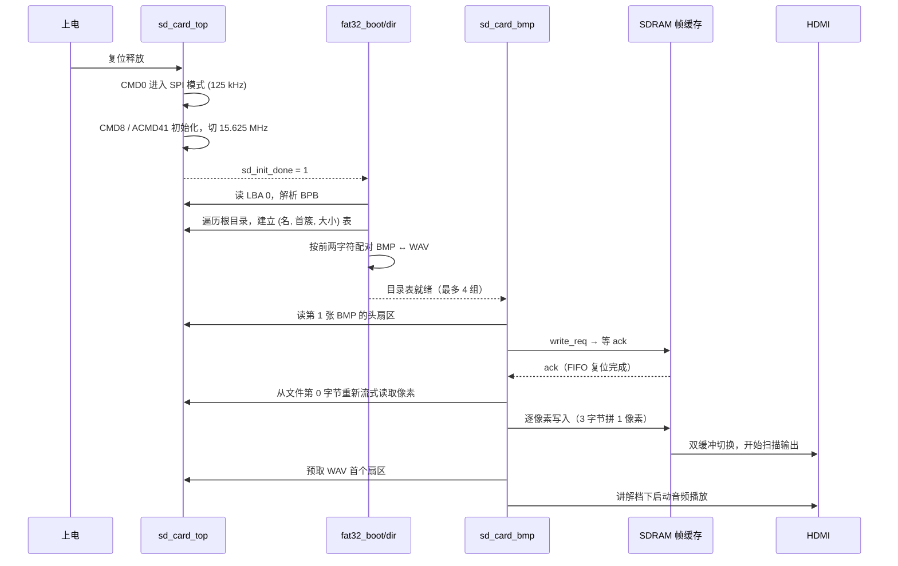

# TF 卡存储完全指南

> 本文覆盖 **接线 → 卡格式 → 素材规格 → 内部实现 → 排障** 全链路。
> 只想知道"怎么用"的读者看第 [1](#1-三分钟上手)、[6](#6-素材规格)、[7](#7-命名与配对规则) 节；
> 想改代码的读者看第 [4](#4-模块分层)、[5](#5-上电流程)、[11](#11-二次开发指引) 节。

---

## 目录

1. [三分钟上手](#1-三分钟上手)
2. [为什么用 SPI 而不是 SD 4-bit](#2-为什么用-spi-而不是-sd-4-bit)
3. [硬件接线](#3-硬件接线)
4. [模块分层](#4-模块分层)
5. [上电流程](#5-上电流程)
6. [素材规格](#6-素材规格)
7. [命名与配对规则](#7-命名与配对规则)
8. [文件系统约束](#8-文件系统约束)
9. [性能数据](#9-性能数据)
10. [排障](#10-排障)
11. [二次开发指引](#11-二次开发指引)

---

## 1. 三分钟上手

```bash
# ① 生成一组合规素材（640x480 渐变图 + 1 kHz 正弦，48 kHz 单声道 16 bit）
python tools/make_media.py --out ./sdcard --index 01

# ② 把 TF 卡格式化为 FAT32，将 01.BMP 与 01.WAV 拷到【根目录】
#    注意：不要放进任何子文件夹

# ③ 插卡上板，上电
```

上电约 1–2 秒后：数码管亮 → HDMI 出图 → 底部字幕开始滚动 → 讲解档下语音自动播放。

**判定成功的三个信号**

| 信号 | 含义 |
|---|---|
| 数码管显示出两位数字 | FAT32 目录扫描完成，数字为识别到的素材组数 |
| HDMI 出现图片 | BMP 装载成功 |
| 播放时字幕上下律动 | WAV 装载成功且音频通路正常 |

---

## 2. 为什么用 SPI 而不是 SD 4-bit

| 维度 | SPI 模式（本设计） | SD 4-bit 模式 |
|---|---|---|
| 信号线 | **4 根**（CS / CLK / MOSI / MISO） | 6 根（CLK / CMD / DAT0-3） |
| 引脚占用 | 4 个 IO | 6 个 IO + 上拉电阻组 |
| 最高速率 | 理论 25 MHz（本设计跑 15.625 MHz） | 更高（HS 模式 50 MHz） |
| 协议复杂度 | 简单，纯字节流 | 需处理宽总线时序、CRC7/CRC16、总线宽度切换 |
| 实测吞吐 | ≈ 1.4 s 装载一张 921 KB 图 | 更快，但本项目瓶颈不在带宽 |

**结论**：本设计的主要时间开销在**像素处理与帧缓冲搬运**，不在 SPI 带宽。
用 4 根线换取"协议简单、布线容易、调试直观"，是这里更划算的取舍。
15.625 MHz 下单张 640×480 BMP 装载约 1.4 秒，已经够 3 秒档使用（见 [第 9 节](#9-性能数据)）。

---

## 3. 硬件接线

### 3.1 引脚表（来自 `constraints_source/pin.adc`）

| FPGA 信号 | 引脚 | 方向 | TF 卡座引脚 | 标准 SD 名 | 说明 |
|---|---|---|---|---|---|
| `sd_ncs` | **A12** | 输出 | 2 | CS / DAT3 | 片选，**低有效** |
| `sd_dclk` | **A14** | 输出 | 5 | CLK | SPI 时钟，空闲低电平 |
| `sd_mosi` | **A13** | 输出 | 3 | CMD / DI | 主机 → 卡 |
| `sd_miso` | **B14** | 输入 | 7 | DAT0 / DO | 卡 → 主机 |
| `3.3V` | — | 电源 | 4 | VDD | 卡座供电（**切勿接 5 V**） |
| `GND` | — | 电源 | 6 | VSS | 共地 |

```
        FPGA (EG4S20BG256)                    microSD 卡座（SPI 模式）
        ┌──────────────┐                      ┌──────────────────┐
        │  sd_ncs  A12 ├──────────────────────┤ 2  CS   (DAT3)   │
        │  sd_dclk A14 ├──────────────────────┤ 5  CLK           │
        │  sd_mosi A13 ├──────────────────────┤ 3  CMD  (DI)     │
        │  sd_miso B14 ├──────────────────────┤ 7  DAT0 (DO)     │
        │  3.3V        ├──────────────────────┤ 4  VDD           │
        │  GND         ├──────────────────────┤ 6  VSS           │
        └──────────────┘                      │ 1  DAT2   (NC)   │
                                              │ 8  DAT1   (NC)   │
                                              │ 9  CD     (NC)   │
                                              │ 10 GND           │
                                              └──────────────────┘
```

### 3.2 布线注意事项

1. **电平**：全部 3.3 V LVCMOS33。EG4S20 的 IO bank 电压需与卡座一致，不要混 5 V。
2. **上拉**：自制底板建议 `sd_miso` 与 `sd_ncs` 各加 **10 kΩ 上拉到 3.3 V**。
   `sd_ncs` 上拉可避免上电瞬间被拉低而误入 SD 模式；`sd_miso` 上拉保证空闲时总线确定。
3. **时钟线**：`sd_dclk` 15.625 MHz 已接近"面包板不可靠"的边界。杜邦线超过 10 cm 时建议降到
   `SPI_HIGH_SPEED_DIV = 2`（≈ 10.4 MHz）先验证功能，再逐步提速。
4. **卡座供电**：部分卡座带电平转换芯片，需确认其支持 3.3 V 供电且不额外引入延时。
5. **热插拔**：本设计**不支持热插拔**。必须在断电状态下插拔卡，上电时完成初始化。

### 3.3 SPI 时钟分频

`sd_card_top` 的两个参数决定速率：

```verilog
parameter SPI_LOW_SPEED_DIV  = 248;   // 初始化阶段
parameter SPI_HIGH_SPEED_DIV = 0;     // 数据传输阶段
// SPI 时钟 = sd_card_clk / ((DIV + 2) * 2)
```

| 阶段 | 计算 | 频率 | 用途 |
|---|---|---|---|
| 初始化 | 62.5 MHz / ((248+2)×2) | **125 kHz** | CMD0 / CMD8 / ACMD41，SD 规范要求 ≤400 kHz |
| 传输 | 62.5 MHz / ((0+2)×2) | **15.625 MHz** | CMD17 / CMD24 |

> 若把 `sd_card_clk` 改成别的频率，这两个分频参数必须同步重算，否则初始化会失败。

---

## 4. 模块分层

TF 卡相关代码集中在 `hardware/hdmi_media_player/src/user_source/hdl_source/`：

```
hdl_source/
├── SD/                          ← TF 卡驱动与播放控制（19 个文件）
│   ├── spi_master.v             SPI 位收发引擎
│   ├── sd_card_cmd.v            命令组包与 R1/R3/R7 响应解析
│   ├── sd_card_sec_read_write.v 单块读写状态机（CMD17 / CMD24）
│   ├── sd_card_top.v            扇区读写顶层，对上层暴露 512 字节块接口
│   ├── sd_arbiter3.v            三路总线仲裁（扫描 / 读图 / 读音频）
│   ├── sd_card_bmp.v            ★ 应用层：轮播编排、配对、进度条、按键
│   ├── wav_player.v             WAV 头校验 + 乒乓缓冲 + 48 kHz 重采样
│   ├── bmp_read.v               旧通路：按起始扇区装载 BMP
│   ├── color_bar.v              彩条测试图（无卡时的兜底画面）
│   ├── frame_fifo_read.v        帧缓存读侧
│   ├── frame_fifo_write.v       帧缓存写侧
│   ├── frame_read_write.v       双缓冲切换
│   ├── sdram.v                  SDRAM 控制器封装
│   ├── video_timing_data.v      640×480 时序发生
│   ├── video_delay.v            像素延迟对齐
│   ├── video_define.v           分辨率宏
│   ├── ax_debounce.v            按键消抖
│   ├── seg_scan.v / seg_decoder.v  数码管扫描与译码
│   └── ...
└── (文件系统层，位于上一级)
    ├── fat32_boot.v             BPB 解析、FAT 表与数据区定位
    ├── fat32_dir.v              根目录扫描 → (8.3 名, 首簇, 大小) 表
    ├── fat32_scan.v             目录遍历与 BMP/WAV 配对
    ├── fat32_file.v             按簇链顺序输出字节流
    └── bmp_load_fat.v           BMP 头解析 + 3 字节拼像素
```

### 4.1 四层职责

| 层 | 模块 | 输入 | 输出 | 关键参数 |
|---|---|---|---|---|
| **应用层** | `sd_card_bmp.v` | 按键、拨码 | 帧缓冲写请求、音频播放控制 | `SCAN_TARGET_COUNT=4`、`CLK_FREQ_HZ=62_500_000` |
| | `bmp_load_fat.v` | 文件表下标 | 24 位像素流 | 要求 `bit_count=24`、`compression=0` |
| | `wav_player.v` | 文件表下标 | 16 bit PCM 采样 | 要求 PCM / 单声道 / 48 kHz / 16 bit |
| **文件层** | `fat32_boot/dir/scan/file` | 扇区读请求 | 文件字节流 | 仅支持 FAT32、仅根目录、8.3 名 |
| **扇区层** | `sd_card_top.v` | 扇区号 | 512 字节块 | `sd_sec_read_addr` 为 **LBA 扇区号**（非字节地址） |
| **物理层** | `spi_master.v` | 字节 | SPI 时序 | 分频参数见 [3.3](#33-spi-时钟分频) |

### 4.2 总线仲裁

三路消费者共享一条 SPI 总线，由 `sd_arbiter3.v` 仲裁：

| 优先级 | 请求方 | 说明 |
|---|---|---|
| 高 | 目录扫描 | 上电初始化阶段独占，此时不显示画面 |
| 中 | BMP 装载 | 换图期间占用，量大（921 KB） |
| 低 | WAV 预取 | 乒乓缓冲，按需补充一个扇区 |

> **为什么 BMP 和 WAV 用两个 `fat32_file` 实例**：合并成一个会串行化，
> 实测音频会晚 3.2 秒起播，音画同步被破坏。代价是 2,195 LUT / 711 REG，
> 这是本项目最大的一处"用面积换体验"。

---

## 5. 上电流程



**关键细节**：BMP 装载分**两相**——

1. **相 1**：只读文件首簇的第 0 个扇区，解析 54 字节头，校验宽/高/位深/压缩；
2. **相 2**：等帧缓冲 `ack` 后，**从文件第 0 字节重新流一遍**做像素。

之所以不"一遍流下来"：帧缓冲要等 `ack` 才复位 FIFO，ack 之前写入的像素会被丢弃。
两相结构每张图多读 1 个扇区（约 0.5 ms），换来的是 `fat32_file` 在 ack 期间根本没启动，
不存在"暂停等 ack 踩超时"的问题。

---

## 6. 素材规格

### 6.1 BMP（图片）

| 项 | 要求 | 校验位置 |
|---|---|---|
| 格式 | Windows BMP（`BM` 魔数） | `bmp_load_fat.v` |
| 位深 | **24 位**（`bit_count == 24`） | 同上，硬校验 |
| 压缩 | **0 = BI_RGB**（未压缩） | 同上，硬校验 |
| 尺寸 | **640×480**，或 **1280×960**（自动 2:1 缩小） | 顶层传入 `bmp_width/bmp_height` |
| 色彩空间 | BGR 顺序、行自下而上（BMP 标准） | 解析时按标准处理 |

> **不满足位深/压缩条件会直接放弃装载**（`err=1`），屏幕上不会出现该图，也不会花屏。
> 常见踩坑：用某些工具"另存为 BMP"默认给 32 位带 Alpha，或给 RLE 压缩——都不认。

### 6.2 WAV（音频）

| 项 | 要求 | 校验位置 |
|---|---|---|
| 容器 | RIFF / WAVE | `wav_player.v` |
| 编码 | **PCM = 1** | 硬校验 |
| 声道 | **单声道 = 1** | 硬校验 |
| 采样率 | **48 000 Hz** | 硬校验 |
| 位深 | **16 bit** | 硬校验 |
| 长度 | 无硬限制，受卡容量与簇链连续性影响 | — |

> 四个条件**全部满足**才会播放（`hdr_canonical` 判据）。立体声、44.1 kHz、24 bit 一律不放。
> 采样率变换用 32 位相位累加器：`SAMPLE_INC = 48000 × 2³² / 25 MHz = 8,246,337`。

### 6.3 用工具生成合规模材

**方式一：仓库自带脚本**

```bash
python tools/make_media.py --out ./sdcard --index 01
python tools/make_media.py --out ./sdcard --index 02 --size 1280x960 --seconds 8 --freq 660
```

**方式二：FFmpeg**

```bash
# 音频：单声道 / 48 kHz / 16 bit PCM
ffmpeg -i narration.mp3 -ac 1 -ar 48000 -sample_fmt s16 -acodec pcm_s16le 01.WAV

# 图片：640x480 / 24 位 / 不压缩
ffmpeg -i photo.jpg -vf scale=640:480 -pix_fmt bgr24 01.BMP
```

**方式三：Photoshop / GIMP**

另存为 BMP 时选 **24 位**、**不压缩（BI_RGB）**，不要选 RLE 或 32 位。

---

## 7. 命名与配对规则

### 7.1 配对逻辑

固件按 **8.3 短文件名的前两个字符**配对 BMP 与 WAV：

```
01.BMP  ↔  01.WAV      ✅ 前两字符 "01" 相同
02.BMP  ↔  02.WAV      ✅
0a.BMP  ↔  0A.WAV      ✅ 大小写不敏感
1.BMP   ↔  1.WAV       ✅ 单字符名同样有效（前两字符 "1\0"）
01.BMP  ↔  02.WAV      ❌ 不成对
```

> 为什么只比前两字节而不是完整文件名：题目与实物素材普遍用 `01/02/03/04` 编号，
> 前两字节足以区分且实现最省逻辑。扩展名字节单独判定，避免 `01.BMP` 抢走 `01.WAV` 的槽。

### 7.2 组数上限

`sd_card_bmp.v` 的 `SCAN_TARGET_COUNT = 4`（顶层例化处覆盖为 `3'd4`）：
**卡上最多识别 4 组**，第 5 组及之后被忽略。

想改成 8 组：修改 `top.v` 中 `SCAN_TARGET_COUNT`，并确认 `fat32_dir` 的目录表深度参数同步放大
（会多占 BRAM，注意 slices 已到 89%）。

### 7.3 长文件名会被忽略

FAT32 支持 LFN（长文件名），但本固件只解析 **8.3 短名**。因此：

- `01.BMP` ✅
- `太阳神鸟-01.BMP` ❌ 短名会变成 `太阳神~1.BMP`，前两字符不再是 `01`

结论：**用纯 ASCII 的 8.3 名字**，长度 ≤8 字符 + `.` + 3 字符扩展名。

---

## 8. 文件系统约束

| 项 | 要求 | 违反后果 |
|---|---|---|
| 文件系统 | **FAT32** | exFAT / NTFS / FAT16 无法识别，数码管无数字 |
| 分区表 | MBR 或 无分区表（superfloppy） | GPT 分区表**不保证**可识别 |
| 文件位置 | **根目录** | 子目录中的文件不被扫描 |
| 簇大小 | 建议 **4 KB ~ 32 KB** | 过大时单文件簇链更长，扫描更慢 |
| 卡容量 | **≤ 32 GB** 较稳妥 | 大卡多为 exFAT 出厂格式，需重新格式化 |

### 格式化命令

**Windows**：

```
format X: /FS:FAT32 /A:32K
```

> Windows 图形界面在 >32 GB 的卡上不提供 FAT32 选项，需用 `diskpart` 或第三方工具。

**Linux**：

```bash
sudo mkfs.vfat -F 32 -s 64 /dev/sdX      # -s 64 → 32 KB 簇
```

**macOS**：

```bash
diskutil eraseDisk MS-DOS "SDCARD" MBR /dev/diskN
```

> **旧通路的 64 MiB 限制**：`SCAN_MAX_SECTOR = 131071` 只作用于 `USE_FAT_SCAN = 0` 的顺序扫描通路
> （在前 64 MiB 内找文件）。本工程顶层已设 `USE_FAT_SCAN = 1`，走 FAT32 表定位，
> **不受该限制**。若你把该开关改回 0，记得把素材放在卡的前 64 MiB 内。

---

## 9. 性能数据

| 指标 | 实测值 | 条件 |
|---|---|---|
| SPI 传输时钟 | 15.625 MHz | `SPI_HIGH_SPEED_DIV = 0`，`sd_card_clk = 62.5 MHz` |
| 640×480×24bit BMP（921 KB） | **≈ 1.4 s** | 含头解析 + 像素流 + 帧缓冲写入 |
| 单张额外开销 | ≈ 0.5 ms | 两相结构多读 1 个扇区 |
| 3 秒档可用展示时间 | **≈ 1.6 s** | 3.0 s 周期 − 1.4 s 装载 |
| 10 秒档可用展示时间 | ≈ 8.6 s | 推荐现场使用 |

> **3 秒档偏紧**是物理约束，不是 bug。素材越大（或用了 1280×960）装载越久，
> 现场演示建议用 **10 秒档或讲解档**。

---

## 10. 排障

| 现象 | 可能原因 | 排查动作 |
|---|---|---|
| 数码管完全不亮 | 未上电 / 位流未加载 / 无卡 | 先不插卡上电，看是否出彩条测试图 |
| 数码管亮但无数字 | SD 初始化失败 | 查 `sd_miso`/`sd_ncs` 上拉；降 SPI 速率（`SPI_HIGH_SPEED_DIV=2`） |
| 数码管显示组数为 0 | 找不到素材 | 确认 FAT32、根目录、8.3 名、扩展名大写 |
| 有数字但 HDMI 黑屏 | BMP 校验失败 | 检查是否 24 位、是否未压缩、尺寸是否 640×480/1280×960 |
| 图正常但无声 | WAV 头校验失败 | 检查 PCM / 单声道 / 48 kHz / 16 bit |
| 声音断续、卡顿 | SPI 仲裁抢占 / 簇链碎片 | 重新格式化并连续拷贝素材，减少碎片 |
| 播到一半停住 | 卡在 64 MiB 之外（旧通路） | 确认 `USE_FAT_SCAN = 1`，或把素材放前面 |
| 换图后字幕没重新开始 | `banner_rst` 逻辑 | 属正常设计：重置由 `I_load_busy` 下降沿触发，非换图瞬间 |
| 图像颜色偏 | BMP 是 32 位或 BGR/RGB 顺序错 | 用 24 位标准 BMP 重新导出 |
| 偶发花屏 | 时序余量 / 走线 | 看 `reports/C77_03_route.qor` 的 WNS；缩短 SPI 走线 |

### 状态码判读

默认 `DIAG_MODE = 0`、总开关 `SW4 = 1` 时，六位数码管的位含义如下
（与 `top.v` 里 `seg_out_5 … seg_out_0` 的赋值一一对应）：

| 位 | 内容 | 判读 |
|---|---|---|
| 位 5 | 轮播档位十位 | 仅"慢观看 10S"档亮 `1`，其余档熄灭 |
| 位 4 | 轮播档位 | `A` 讲解 / `3` 快速浏览 3S / `10` 慢观看 10S / `P` 手动浏览 |
| 位 3 | `fat_err` 错误码 | 十六进制一位，`0` = 无错误 |
| 位 2 | FAT 条数个位 | `sd_card_bmp` 已把 >9 钳到 9 |
| 位 1 | FAT 条数十位 | 正常 `0`；`SW1 = 1`（设置模式）时改为菜单光标 `0`~`3` |
| 位 0 | TF 卡状态码 `state_code` | 十六进制一位，`0` = 空闲 |

总开关 `SW4 = 0`（锁定）时：位 4 显示 `L`、位 1 显示 `C`，其余位熄灭。

> `DIAG_MODE = 1` 时六位数码管改为 16 页诊断显示（页号在位 0，0~F），
> 每页内容见 `top.v` 里 "临时诊断显示" 段注释（页 2/3/4 是字幕掩膜，页 C~F 是 FAT 装载）。
> **改了扫描或显示逻辑记得同步改这段**，否则排障时会看到误导性数字。

---

## 11. 二次开发指引

| 想做的事 | 改哪里 | 注意事项 |
|---|---|---|
| 支持更多组素材 | `top.v` 的 `SCAN_TARGET_COUNT` + `fat32_dir` 表深 | 多占 BRAM，slices 仅剩 0.94 pt 余量 |
| 提速到 25 MHz | `SPI_HIGH_SPEED_DIV` 改为 2 以下需重算；`sd_card_clk` 也可提高 | 卡座与走线质量决定上限 |
| 支持 1920×1080 | `video_define.v` + `video_timing_data.v` + 像素时钟 | 帧缓存容量翻 4 倍，SDRAM 带宽吃紧 |
| 支持写卡（存截图/日志） | `sd_card_top.v` 已实现 CMD24，接上层即可 | 需自行处理 FAT 表更新与簇分配 |
| 换 exFAT | 需重写文件层 | exFAT 无固定根目录、目录项格式不同，工作量大 |
| 加断电保护 | 写卡时避免掉电 | 本项目只读，无此风险 |

---

## 附：相关文件索引

| 主题 | 文件 |
|---|---|
| 引脚约束 | `hardware/hdmi_media_player/src/user_source/constraints_source/pin.adc` |
| 顶层例化与参数覆盖 | `hdl_source/top.v`（搜索 `sd_card_bmp`） |
| 应用层状态机 | `hdl_source/SD/sd_card_bmp.v` |
| 音频格式校验 | `hdl_source/SD/wav_player.v`（`hdr_canonical`） |
| 图片格式校验 | `hdl_source/bmp_load_fat.v`（`header_match`） |
| 配对规则 | `hdl_source/fat32_boot.v`（前两字节比较段） |
| 素材生成脚本 | `tools/make_media.py` |
